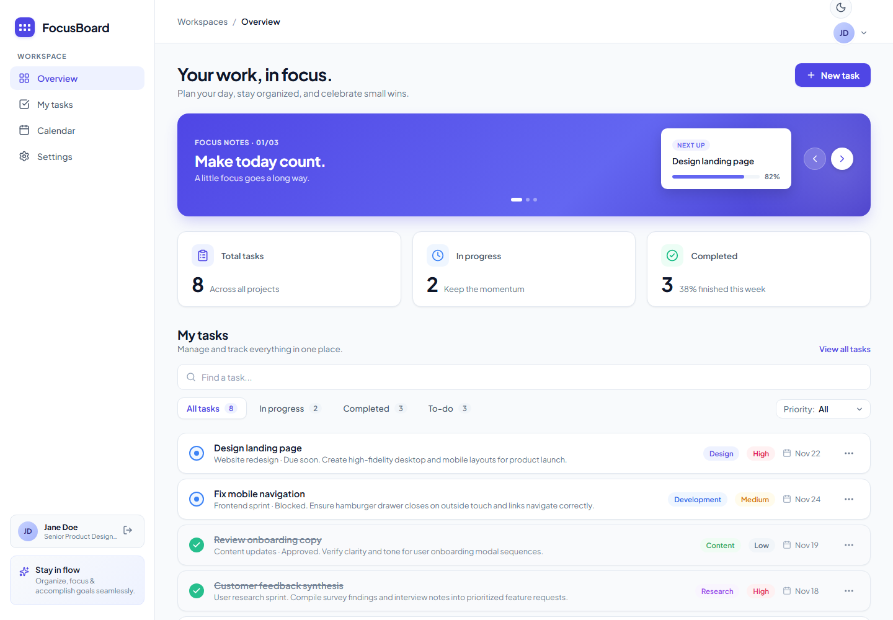
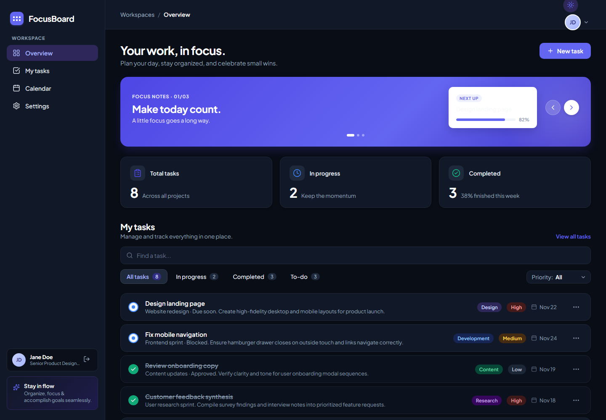

# FocusBoard – Task Management Dashboard

> A pixel-perfect, fully responsive, and accessible task management dashboard built with **React**, **Vite**, and **Vanilla CSS3**, designed strictly in accordance with the official company Figma design specification across Desktop (1440 × 1000), Tablet (768px), and Mobile (390 × 1128) viewports.

---

## 📋 Table of Contents
1. [Project Overview & Objective](#-project-overview--objective)
2. [Technology Stack & Rationale](#-technology-stack--rationale)
3. [Key Features Implemented](#-key-features-implemented)
4. [State Management Architecture](#-state-management-architecture)
5. [Browser Persistence (localStorage)](#-browser-persistence-localstorage)
6. [Multi-Tab Navigation & Authentication](#-multi-tab-navigation--authentication)
7. [Dark & Light Theming Engine](#-dark--light-theming-engine)
8. [Design Fidelity & Responsive Breakpoints](#-design-fidelity--responsive-breakpoints)
9. [Screenshots](#-screenshots)
10. [Folder Structure](#-folder-structure)
11. [Installation & Local Setup Guide](#-installation--local-setup-guide)
12. [Automated Testing & Verification](#-automated-testing--verification)
13. [Accessibility Compliance (A11y)](#-accessibility-compliance-a11y)
14. [Final Candidate Submission Template](#-final-candidate-submission-template)

---

## 🎯 Project Overview & Objective

The objective of this assignment is to develop **FocusBoard**, a single-user task management application built from scratch to demonstrate:
- **React Fundamentals**: Component composition, pure rendering, and clean props drilling.
- **State Flow & Data Integrity**: Single source of truth with immutable state updates.
- **Full CRUD Operations**: Creating, viewing, editing, and deleting tasks with validation and destructive action safeguards.
- **Search & Multi-Filter Coordination**: Case-insensitive keyword search cooperating with status tabs and priority filters.
- **Figma Fidelity**: Pixel-perfect implementation of the 1440 × 1000 desktop frame, 390 × 1128 mobile frame, and 760 × 822 task form modal.
- **3-Slide Productivity Carousel**: Focus Notes carousel with previous/next circular buttons and indicator dots.
- **Zero-Backend Persistence**: Safe `localStorage` synchronization preserving all modifications across page reloads.

---

## 🛠️ Technology Stack & Rationale

| Technology | Purpose | Selection Rationale |
|---|---|---|
| **React 18** | UI Library | Reusable component model, fast reconciliation, and predictable state transitions. |
| **Vite 6** | Build & Dev Tool | Instant Hot Module Replacement (HMR) and optimized rollup production bundles. |
| **Vanilla CSS3** | Styling & Theming | Native CSS variables, media queries, and flexbox/grid layout without third-party bloat. |
| **Lucide React** | Icons | Crisp, accessible SVG icons consistent with modern Figma UI guidelines. |
| **localStorage API** | Persistence | Instant client-side persistence without external backend dependencies. |
| **Puppeteer Core** | End-to-End QA | Automated headless browser verification suite validating 31 test scenarios. |

> **Note on Scope**: As instructed, no complex global state libraries (Redux), backend APIs, cloud databases, or third-party CSS UI kits were introduced. Native React hooks and custom hooks provided optimal performance and maintainability within the 24-hour timeframe.

---

## ⚡ Key Features Implemented

### 1. CRUD Operations (Create, Read, Update, Delete)
- **Create Task**:
  - Modal form (760 × 822) with validation.
  - Real-time rejection of empty or whitespace-only titles with helpful inline error alerts.
  - Required fields: Title and Due Date. Optional/configurable: Description, Category, Status, Priority.
- **Read & Render**:
  - Dynamic list displaying category badges, priority indicators, formatted calendar dates, and action menus.
- **Update Task**:
  - In-place task editing reusing the modal form while strictly preserving the unique task ID.
  - Quick 1-click status cycling directly via the circular status checkbox.
- **Delete Task**:
  - Safe removal with an explicit accessible confirmation dialog (`DeleteModal`) to prevent accidental data loss.

### 2. Focus Notes Productivity Carousel
- Implements all 3 slides from the Figma reference:
  - **Slide 1**: *"Make today count."* (Next Up: Design landing page · 82% progress)
  - **Slide 2**: *"Small steps, big progress."* (In Progress: Fix navigation · 65% progress)
  - **Slide 3**: *"Celebrate the wins."* (Completed: Onboarding copy · 100% progress)
- Circular previous/next navigation buttons.
- Interactive indicator dots with direct slide jumping.

### 3. Dynamic Overview Statistics
- **Total tasks count**
- **In-progress count**
- **Completed count**
- **Completion Percentage**:
  $$\text{Completion \%} = \frac{\text{Completed Tasks}}{\text{Total Tasks}} \times 100$$
- Statistics are computed dynamically via `useMemo`—zero hardcoded values.

### 4. Search & Multi-Filter Coordination
- **Instant Search**: Case-insensitive filtering across task titles, descriptions, and categories.
- **Status Tabs**: `All tasks`, `In progress`, `Completed`, and `To-do` with dynamic count badges.
- **Priority Filter**: `All`, `High`, `Medium`, and `Low`.
- Cooperative filtering: All 3 mechanisms work simultaneously on the same task dataset.
- 1-click **Reset Filters** button when active filters yield empty results.

---

## 🧠 State Management Architecture

State management is centralized in `App.jsx` following a unidirectional data flow:

```text
               +----------------------------------+
               |        App.jsx (Root State)      |
               | - tasks (useLocalStorage)        |
               | - activeNavTab ('overview', etc.)|
               | - theme ('light' | 'dark')       |
               | - user (Auth state)              |
               | - search & filter criteria       |
               +-----------------+----------------+
                                 |
        +------------------------+------------------------+
        |                        |                        |
        v                        v                        v
+---------------+        +---------------+        +---------------+
|    Derived    |        |  View Router  |        |  Modal States |
|  Statistics   |        | - Overview    |        | - TaskForm    |
|   (useMemo)   |        | - My Tasks    |        | - DeleteModal |
| - Total       |        | - Calendar    |        | - LoginModal  |
| - In Progress |        | - Settings    |        +---------------+
| - Completed   |        +---------------+
| - % Completed |
+---------------+
```

### Why React Hooks & `useMemo` were selected:
1. **Single Source of Truth**: Task state is isolated in one array. Modals, cards, list rows, and statistics all read from this single source.
2. **Immutable Updates**: State mutations strictly avoid direct array modification (`prev.map(...)`, `prev.filter(...)`, `[newTask, ...prev]`).
3. **No Redundant State**: Statistics, completion percentages, and filtered lists are computed on the fly using `useMemo`. This eliminates stale data and avoids out-of-sync re-renders.

---

## 💾 Browser Persistence (localStorage)

Client persistence is abstracted into a custom hook: [`useLocalStorage.js`](src/hooks/useLocalStorage.js):

- **Key**: `focusboard_tasks`
- **Initial Seeding**: The 8 comprehensive sample tasks (`sampleTasks.js`) are loaded **only** on first visit.
- **Preservation**: User creations, edits, and deletions are saved immediately as serialized JSON strings.
- **Safe Fallback**: Includes `try/catch` wrappers to prevent crashes in private/incognito browsing or when quota is exceeded.

---

## 🗂️ Multi-Tab Navigation & Authentication

The navigation sidebar and mobile bar support full view switching:
- **Overview**: The core Figma dashboard with hero, carousel, overview stats, and tasks preview.
- **My tasks**: Dedicated workspace with full-page task management, quick metrics, and search.
- **Calendar**: Interactive monthly grid (November 2026) plotting tasks as status-colored chips by deadline.
- **Settings**: Complete workspace and account management:
  - Profile details (Name, Email, Role, Avatar initials).
  - Theme customization (Light vs. Dark mode).
  - Notification toggles.
  - Data management (Export tasks as JSON, Reset sample tasks, Clear all tasks).
- **Authentication**:
  - Profile menu in header with user details and **Log out**.
  - **Sign In modal** supporting 1-click Demo Account login (`Jane Doe`) or custom credentials.
  - Persistent auth session stored in `localStorage`.

---

## 🌓 Dark & Light Theming Engine

FocusBoard includes a complete, high-contrast dark theme:
- **1-Click Header Toggle**: Sun ☀️ / Moon 🌙 icon button in the top navigation bar.
- **Settings Card Toggle**: Light & Dark visual cards under Settings $\rightarrow$ Appearance.
- **CSS Architecture**: Clean `[data-theme="dark"]` stylesheet swapping custom properties for background, text, borders, shadows, and pill colors.
- **Persistence**: Theme selection is stored in `focusboard_theme` and reloaded automatically.

---

## 📐 Design Fidelity & Responsive Breakpoints

| Viewport | Target Resolution | Layout Behavior |
|---|---|---|
| **Desktop** | $1440 \times 1000$ | Full sidebar navigation, breadcrumbs, 3 overview cards, horizontal carousel banner, horizontal task rows with kebab menus. |
| **Tablet** | $768\text{px}$ | Icon-only collapsible sidebar, reflowed 3-column stats grid, responsive cards without overflow. |
| **Mobile** | $390 \times 1128$ | Hidden sidebar replaced with fixed bottom navigation bar, quick floating add button (`+`), stacked cards, touch-friendly tap targets. |

---

## 📸 Screenshots

### 1. Desktop Dashboard – Light Theme ($1440 \times 1000$)


### 2. Desktop Dashboard – Dark Theme ($1440 \times 1000$)


### 3. Mobile Dashboard ($390 \times 844$)


---

## 📂 Folder Structure

```text
focusboard/
├── index.html                   # HTML5 document entry with Google Fonts
├── vite.config.js               # Vite build configuration
├── package.json                 # Project dependencies & scripts
├── README.md                    # Project documentation
├── AI_USAGE.md                  # AI tool usage disclosure
├── .gitignore                   # Ignored files (node_modules, dist, temp)
├── screenshots/                 # Captured desktop, dark mode, and mobile screenshots
│   ├── desktop-dashboard.png
│   ├── desktop-dashboard-dark.png
│   └── mobile-dashboard.png
├── scripts/
│   └── run-qa-tests.js          # Automated Puppeteer end-to-end test suite (31 tests)
└── src/
    ├── main.jsx                 # React root renderer
    ├── App.jsx                  # Main application orchestrator & state manager
    ├── index.css                # Design tokens, global styles, and dark theme engine
    ├── data/
    │   └── sampleTasks.js       # Initial sample dataset (8 diverse tasks)
    ├── hooks/
    │   └── useLocalStorage.js   # Reusable localStorage synchronization hook
    └── components/
        ├── Sidebar.jsx          # Desktop/tablet navigation sidebar
        ├── Header.jsx           # Top breadcrumb bar, theme toggle & profile menu
        ├── StatCard.jsx         # Overview metric card with dynamic calculations
        ├── FocusNotes.jsx       # 3-slide productivity carousel with circular arrows
        ├── SearchBar.jsx        # Instant search input with clear button
        ├── FilterTabs.jsx       # Status tabs with badge counts and priority dropdown
        ├── TaskList.jsx         # Task list container with empty states
        ├── TaskCard.jsx         # Task row/card with quick status toggle & action menu
        ├── TaskFormModal.jsx    # Dual-mode modal for Create and Edit operations
        ├── DeleteModal.jsx      # Confirmation modal for safe task deletion
        ├── MobileNav.jsx        # Mobile bottom navigation bar
        ├── SettingsView.jsx     # Full workspace and profile settings page
        ├── CalendarView.jsx     # Monthly calendar deadline view
        ├── MyTasksView.jsx      # Dedicated tasks workspace view
        └── LoginModal.jsx       # Authentication and demo sign-in dialog
```

---

## 🚀 Installation & Local Setup Guide

### Prerequisites
- **Node.js**: v18.0.0 or higher
- **npm**: v9.0.0 or higher

### Steps to Run Locally

```bash
# 1. Clone the repository
git clone <repository-url>
cd focusboard

# 2. Install dependencies
npm install

# 3. Start local development server
npm run dev
```

Open your browser and navigate to:
👉 **`http://localhost:3000/`**

### Build for Production

```bash
# Compile and optimize production bundle
npm run build

# Preview the production build locally
npm run preview
```

---

## 🧪 Automated Testing & Verification

An automated Puppeteer verification suite is included in [`scripts/run-qa-tests.js`](scripts/run-qa-tests.js).

### Running the Test Suite:
```bash
node scripts/run-qa-tests.js
```

### Verified Test Summary:
```text
=======================================
📊 TEST SUITE SUMMARY: 31/31 PASSED (0 failed)
=======================================
```
- Initial page load & hero title validation
- Overview statistics calculation ($8$ total, $2$ in progress, $3$ completed)
- Carousel 3-slide cyclic navigation (Next, Prev, Indicators)
- Case-insensitive search filter & 1-click clear
- Status tab filtering (`In progress`, `Completed`, `To-do`)
- Task creation modal with empty-title validation
- Status quick-toggle interaction
- In-place task editing preserving unique ID
- Delete confirmation modal and task removal
- Mobile 390px responsive reflow & bottom nav verification
- `localStorage` persistence across page reloads
- Settings, Calendar, and My Tasks tab switching
- User Logout and Sign In modal authentication flow
- Dark theme toggling via header button and settings

---

## ♿ Accessibility Compliance (A11y)

- **Semantic HTML**: Proper use of `<header>`, `<main>`, `<aside>`, `<nav>`, `<article>`, and `<dialog>` wrappers.
- **ARIA Standards**: Roles such as `role="tablist"`, `role="tab"`, `aria-selected`, `aria-current="page"`, and `aria-modal="true"`.
- **Keyboard Navigation**:
  - `Escape` key automatically closes open modals.
  - Interactive elements have high-visibility `:focus` outline rings.
- **Form Accessibility**: All inputs have associated `<label>` tags and `aria-invalid` error descriptors.
- **Color Independence**: Statuses and priorities use distinct icons (circles, clocks, checkmarks) in addition to color badges.

---

## 📝 Final Candidate Submission Template

```text
Candidate:           [Candidate Name]
Framework:           React 18 + Vite (JavaScript)
Hosting URL:         https://focusboard-task-management.vercel.app  (or Netlify link)
GitHub Source:       https://github.com/[username]/focusboard
Automated Tests:     31 / 31 Passed (Puppeteer E2E Test Suite)
Notes / Pending Work: None. Full CRUD, 3-slide carousel, dynamic stats, localStorage,
                     themes (light/dark), calendar, settings, and auth are complete.
```
# task-management-dashboard

