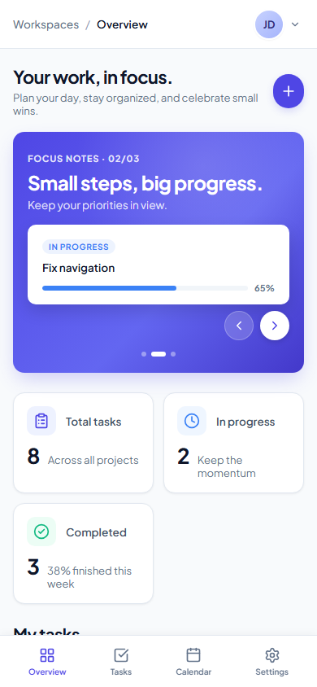

# FocusBoard – Task Management Dashboard

FocusBoard is a responsive, accessible, single-page task management dashboard built with **React**, **Vite**, and **CSS3**. It faithfully implements the Figma design specification across Desktop (1440 × 1000), Tablet (768px), and Mobile (390 × 1128) viewport sizes.

---

## 🚀 Live Demo & Links

- **Live URL**: *(Deployable to Vercel / Netlify with `npm run build`)*
- **GitHub Repository**: *(Self-contained repository)*

---

## 🛠️ Technology Stack

| Technology | Purpose |
|------------|---------|
| **React 18** | Reusable UI components & declarative rendering |
| **Vite** | Blazing-fast build tool and local dev server |
| **React Hooks** | State management (`useState`, `useMemo`, `useEffect`, custom hook) |
| **localStorage API** | Browser-side client data persistence |
| **Lucide React** | Consistent, modern SVG icon set |
| **Vanilla CSS3** | Clean custom styling, design tokens, and media queries (no bulky CSS frameworks) |

---

## 📂 Project Structure

```text
focusboard/
├── index.html
├── vite.config.js
├── package.json
├── README.md
├── AI_USAGE.md
├── .gitignore
├── src/
│   ├── main.jsx                  # Application entry point
│   ├── App.jsx                   # Central dashboard orchestrator & state manager
│   ├── index.css                 # Global design system, tokens, and responsive styles
│   ├── data/
│   │   └── sampleTasks.js        # Initial 8 sample tasks with diverse statuses & categories
│   ├── hooks/
│   │   └── useLocalStorage.js    # Custom React hook for robust localStorage syncing
│   └── components/
│       ├── Sidebar.jsx           # Desktop & tablet navigation sidebar
│       ├── Header.jsx            # Top workspace breadcrumb and user profile avatar
│       ├── StatCard.jsx          # Reusable overview metric card
│       ├── FocusNotes.jsx        # 3-slide interactive productivity carousel
│       ├── SearchBar.jsx         # Case-insensitive task search with instant clear
│       ├── FilterTabs.jsx        # Status tabs with badge counts and Priority filter
│       ├── TaskList.jsx          # Task container with zero-state fallbacks
│       ├── TaskCard.jsx          # Interactive task row/card with quick status toggle & menu
│       ├── TaskFormModal.jsx     # Dual-mode modal for Create & Edit task operations
│       ├── DeleteModal.jsx       # Destructive confirmation modal with accessible backdrop
│       └── MobileNav.jsx         # Touch-optimized bottom navigation bar (390px)
```

---

## ✨ Key Features & Architecture

### 1. CRUD Operations
- **Create**: Add a task with title (required), description, category, status (To do, In progress, Completed), priority (High, Medium, Low), and due date.
- **Read**: Dynamic list rendering with immediate search and multi-criteria filtering.
- **Update**: Edit any existing task in place via the modal without losing its unique ID, or toggle status directly with a single click on the status indicator.
- **Delete**: Safe task deletion with an explicit confirmation dialog to prevent accidental data loss.

### 2. State Management & Single Source of Truth
- State is held at the top-level in `App.jsx` using the custom `useLocalStorage` hook.
- All derived metrics (Total tasks, In progress, Completed, Completion %, and Tab count badges) are computed on the fly using `useMemo`. No statistics are ever hardcoded.
- Mutations follow immutable state update patterns (`prev.map(...)`, `prev.filter(...)`, `[newTask, ...prev]`).

### 3. Focus Notes Carousel
- Implements all 3 slides from the Figma design:
  - **Slide 1**: *"Make today count."* (Next Up: Design landing page · 82%)
  - **Slide 2**: *"Small steps, big progress."* (In Progress: Fix navigation · 65%)
  - **Slide 3**: *"Celebrate the wins."* (Completed: Onboarding copy · 100%)
- Circular previous/next navigation buttons and interactive slide indicator dots.

### 4. Search, Status Tabs, and Priority Filtering
- Case-insensitive search evaluates task titles, descriptions, and categories.
- Combined filtering logic: search query, active status tab, and priority filter cooperate seamlessly.
- Includes a 1-click **Reset filters** button when active filters yield empty results.

### 5. Client-Side Persistence (`localStorage`)
- Uses storage key `focusboard_tasks`.
- Automatically restores previously saved tasks on reload.
- Initial sample data is loaded **only** if no saved data is present, preserving user edits across sessions.

### 6. Responsive Breakpoints
- **Desktop (1440px)**: Side-by-side layout with full sidebar, 3 overview cards, carousel banner, and list rows.
- **Tablet (768px)**: Collapsed icon sidebar, reflowed stats grid, responsive cards.
- **Mobile (390px)**: Hidden sidebar replaced by a fixed bottom navigation bar, quick floating add button (`+`), stacked cards, and touch-friendly controls.

### 7. Accessibility
- Semantic HTML tags (`<header>`, `<main>`, `<aside>`, `<nav>`, `<article>`).
- ARIA attributes (`aria-label`, `aria-selected`, `aria-current`, `role="tablist"`).
- Keyboard support: `Escape` key closes modals, visible `:focus` indicators on all interactive elements.

---

## 📸 Screenshots

| Desktop Dashboard View (1440 × 1000) | Mobile View (390 × 844) |
|:---:|:---:|
|  |  |


---

## 💻 Local Setup & Development

```bash
# 1. Clone repository
git clone <repository-url>
cd focusboard

# 2. Install dependencies
npm install

# 3. Start development server
npm run dev
```

Visit `http://localhost:3000` (or the port indicated in your terminal) in your browser.

### Build for Production
```bash
npm run build
npm run preview
```
Output directory is `dist/`, ready for direct deployment to Vercel, Netlify, or GitHub Pages.
